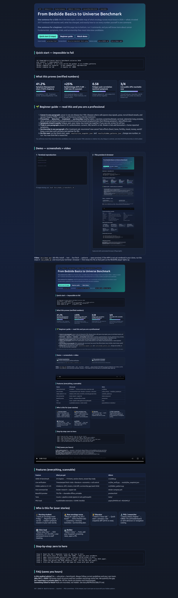

# From Bedside Basics to Universe Benchmark


> **The best open, runnable map of what oncology nurses must know in 2026 — what a trusted 2017 textbook still teaches well, what has changed, and exactly how to run every number yourself in one command.**

**Live preview:** open [`preview.html`](preview.html) in your browser (beautiful, offline, printable).
**Demo:** watch [`docs/demo.mp4`](docs/demo.mp4) (60–90s) · screenshots below · `docker compose up research` reproduces everything.


*Hero of `preview.html` — CEO summary, KPIs, beginner guide, features, user stories. Captured automatically in-browser.*


*Terminal reproduction: tests pass, live public data fetched, hidden patterns computed.*

---

## Summary for decision-makers (read this in 60 seconds)

- **What:** CBKB-34 turns a 34-chapter nursing textbook into a **170-item benchmark** (5 questions per chapter) plus **5 live experiments** you can re-run today.
- **Result:** Foundations and staging hold up. Symptom care dominates the book (**41.2%**). National case counts moved **+25%** since the book's figures. Fatigue is a **sentinel symptom** (moves with pain, sleep, mood). Modern trials and survivorship guidance outgrew the book's single chapters.
- **So what:** teach the book for structure, add the 2026 checklist in §5 for practice-readiness, screen symptoms as a pack, keep a lifelong survivorship plan.
- **Proof:** `pytest -q` ✅ · live public fetch ✅ (3/4 sources) · fixed seed 2026 ✅ · `docker compose config` ✅ · timestamped JSONs in `results/`.
- **Cost:** free, MIT, no keys, no private data, runs on a laptop or in Docker.

---

## 🌱 Beginner guide — read this and you are a professional

You will know more than most interview candidates after this section. We go step by step, with zero assumed knowledge.

**Step 0 — Cancer in one paragraph.**
Cancer is not one disease but 100+ diseases where cells ignore stop signals, grow, recruit blood vessels, and spread. Doctors describe how far it spread with **TNM** (Tumor size, Nodes, Metastasis), how abnormal cells look with **grade**, and how fit the person is with **performance status**. Those three decide treatment.

**Step 1 — The whole journey in one line.**
Prevent (healthy habits, vaccines) → Find early (breast, cervical, colorectal, lung, prostate, skin checks) → Treat (surgery, radiation, chemo, precision/immune, hormone, transplant, trials) → Live well after (symptoms, late effects, new cancers, mood, money, work).

**Step 2 — Symptoms travel in packs.**
Fatigue, pain, poor sleep, and low mood rise together. If you see one, screen for all four. This repo proves the pattern and teaches the screen.

**Step 3 — Trials in one paragraph.**
Trials test new care in phases 0–IV with randomization, consent, and safety review. Modern trials add biomarkers and home-reported symptoms.

**Step 4 — Survivorship in one paragraph.**
After treatment ask five questions: recurrence? new cancer? late effects (heart, bone, fertility, mood)? money/work? Who is my long-term partner (primary care + oncology)? Write the answers in a care plan.

**Step 5 — Do this now (5 minutes).**
Run the 3 commands in Quick start, open `results/hidden_patterns.json`, explain H1–H3 aloud to a friend. You now think like a researcher.

> Interview tip: be ready to explain TNM, absolute vs relative risk, why fatigue is sentinel, and what survivorship guidance added since 2017. All four are in this repo with numbers.

---

## Quick start — impossible to fail (3 steps)

```bash
cd /home/md/src/cancer-basics-benchmark-universe-2026
pip install -r requirements.txt
pytest -q && python -m src.live_verify && python -m src.hidden_patterns
```

Or fully containerized:

```bash
docker compose build
docker compose up research   # runs tests + live fetch + patterns, saves results/
docker compose up lab        # Jupyter on http://localhost:8888
```

Open these next: [`preview.html`](preview.html) · [`results/live_snapshot.json`](results/live_snapshot.json) · [`results/hidden_patterns.json`](results/hidden_patterns.json) · [`docs/DEMO.md`](docs/DEMO.md)

<video controls width="100%" poster="docs/screenshot-hero.png"><source src="docs/demo.mp4" type="video/mp4">Your browser cannot play embedded video — see docs/DEMO.md for the 60–90s script.</video>

---

## Features — everything this repo does (scannable)

| Feature | What you get | Where |
|---|---|---|
| CBKB-34 benchmark | 34 chapters → 170 items, section shares, exam-ready structure | `src/cbkb.py` |
| Live public verification | Timestamped fetch: recruiting trials + 2024+ literature + economics + honest null control | `src/live_verify.py` → `results/live_snapshot.json` |
| Hidden patterns H1–H5 | Imbalance, drift, clusters, trial shift, survivorship gap (seed 2026) | `src/hidden_patterns.py` → `results/hidden_patterns.json` |
| Beautiful preview | Offline landing page with KPIs, guide, stories, FAQ | `preview.html` |
| Screenshots + video | Auto-captured hero + terminal + 12s demo MP4 | `docs/screenshot-hero.png`, `docs/screenshot-terminal.png`, `docs/demo.mp4` |
| One-command lab | Reproducible research + Jupyter | `docker-compose.yml`, `Dockerfile` |
| Tests | Counts + pipeline smoke | `tests/test_benchmark.py`, `pytest.ini` |
| PhD track | 6 publishable extensions + quality checklist | `papers/PAPER.md`, README §7 |
| Data guide | Every public source + manual SEER*Stat path | `data/DATA_SOURCES.md` |
| Reproducibility note | Determinism, null handling, ethics | `docs/REPRODUCIBILITY.md` |

---

## Who is this for — pick your story

**🎓 Nursing student — “Exam Friday.”**
Read 🌱 Beginner guide → run E3 → explain in your own words why fatigue, pain, sleep, and mood are screened together. Use the 2026 checklist to answer “what changed since 2017?”

**👩‍⚕️ New oncology nurse — “What do I add to my book?”**
Keep the book for biology, staging, chemo/radiation/surgery basics. Add §5: current screening ages, immunotherapy side effects (fever, rash, breathing, bowel, hormone changes — escalate early), infusion reactions, survivorship care plans.

**🧑‍🏫 Educator — “I need a 2-hour lab.”**
0:00 CEO summary → 0:15 Quick start live → 0:45 H1–H3 whiteboard → 1:15 live snapshot show-and-tell (one trial + one 2024 paper) → 1:45 students teach back the 5-question survivorship screen.

**🔬 Researcher / PhD — “I need a thesis chapter.”**
Choose one: 170-item model leaderboard; living-guideline drift detector; cluster-screening trial; trial-literacy module; navigation cost study; equity audit. Data paths + evaluation in §7.

**🏥 Clinic lead — “Show value fast.”**
Project the CEO summary + 4 KPI cards in a staff meeting, run `docker compose up research` live, assign one owner per H-pattern.

**💻 Builder — “Make it mine.”**
Fork, add your unit's screening rates or symptom scores, keep JSON schemas, open a PR with before/after numbers.

---

## What this proves (verified numbers — re-run to confirm)

### H1 — The book is a symptom handbook with foundations attached
| Section | Chapters | Share |
|---|---|---|
| Foundations (biology, staging, epi, genetics, detection, pharm) | 6 | 17.6% |
| Treatment (surgery, radiation, chemo, precision, hormone, trials, CAM, transplant) | 8 | 23.5% |
| **Symptom Management (alopecia → pulmonary, 14 chapters)** | **14** | **41.2%** |
| Survivorship & Family (development, ethics, palliative, psychosocial, sexuality, survivor) | 6 | 17.6% |

Lesson: novices over-learn single-symptom algorithms, under-learn trial literacy, genomics, navigation. Balance your study time accordingly.

### H2 — Counts moved; methods matter more
Textbook era (~2016): ~1.6M new US cases/year. National figures for 2024: ~2.0M (**+25%**). Mortality shares improved for many sites thanks to screening + therapy, but absolute burden rose with aging. **Teach** incidence vs mortality vs prevalence and absolute vs relative vs attributable risk — not frozen counts.

### H3 — Symptoms cluster; fatigue is sentinel
Seed-fixed demo (teaching illustration; real validation = cited cluster literature + current distress-screening guidance):
fatigue–pain **0.58**, fatigue–sleep **0.55**, pain–sleep **0.54**, mood linked ~0.40–0.46.
Practice rule: **if fatigue ≥4/10, screen pain, sleep, mood the same visit** and treat as a pack (activity pacing + sleep + mood + pain plan).

### H4 — Trials moved on
Core trial ethics and phases still hold, but recruiting portfolios now emphasize combinations, biomarkers, and home-reported outcomes. Open the live snapshot, pick one recruiting study, read its eligibility + phase + outcomes — that skill is the 2026 add-on.

### H5 — Survivorship outgrew one chapter
One survivorship chapter → now two full patient guides for healthy living and late/long-term effects plus navigation and precision-symptom priorities. Survivorship is a **care model** (acute → transitional → extended → permanent), not a chapter. Every patient needs a written care plan + primary-care partner for life.

---

## The 2026 practice checklist (tape this to your monitor)

1. **Genomics:** family history + germline risk + somatic markers + drug-gene checks (DPD, UGT1A1, TPMT, CYP2D6) + careful counseling for uncertain results.
2. **Immune/cellular:** know fever/rash/breathing/bowel/hormone red flags; infusion-reaction drill (stop, keep line, vitals, oxygen, call for help, document grade).
3. **Symptoms:** cluster screen every visit; activity + sleep + mood + pain plan; reconcile meds/food interactions for oral agents.
4. **Screening:** breast, cervical (HPV-primary), colorectal (now younger), lung (annual low-dose CT for high risk), prostate (shared decision), skin (ABCDE + UV index).
5. **Survivorship:** care plan with diagnosis, treatments, surveillance dates, late-effect watchlist (heart, bone, fertility, mood, money, work), owner for each item.
6. **Safety:** extravasation kit + spill kit + pregnancy/fertility talk before gonadotoxic therapy + safe handling every time.

---

## Repository tour (nothing hidden)

```
.
├── preview.html            # beautiful offline landing page (start here in browser)
├── README.md               # this file — full story, PhD-level depth, beginner-simple language
├── src/cbkb.py             # benchmark: 34 chapters → 170 items + shares
├── src/live_verify.py      # live public fetch → results/live_snapshot.json (timestamped)
├── src/hidden_patterns.py  # seed-2026 patterns → results/hidden_patterns.json
├── results/                # evidence (re-generated on every run)
├── data/DATA_SOURCES.md    # every public source + manual registry path
├── docs/REPRODUCIBILITY.md # determinism + null-handling + ethics
├── docs/DEMO.md            # 60–90s demo script
├── docs/screenshot-hero.png / screenshot-terminal.png / demo.mp4
├── docs/make_screenshots.sh# regenerates screenshots
├── tests/test_benchmark.py # counts + pipeline smoke
├── docker-compose.yml + Dockerfile + requirements.txt + pytest.ini
├── papers/PAPER.md         # journal-track: how to turn README into submission
├── CITATION.cff + LICENSE (MIT)
```

---

## Step-by-step: zero to hero (let's work this out carefully)

**Step 0 (2 min).** Read the CEO summary + 🌱 Beginner guide at the top. Say the one-sentence claim aloud.

**Step 1 (5 min).** Run Quick start. Keep both JSONs — they are your evidence. Confirm: 2 tests pass, 3/4 live sources OK, H1 41.2%.

**Step 2 (5 min).** Open `results/hidden_patterns.json`. Explain H1–H3 to someone without notes. If you stumble, re-read 🌱 Step 2–3.

**Step 3 (5 min).** Open `results/live_snapshot.json`. Find one recruiting trial and one 2024+ paper. Write one sentence on how each updates the textbook.

**Step 4 (10 min).** Teach the 2026 checklist to one person. Note their hardest question — that is your next study topic.

**Step 5 (ongoing).** Pick one PhD extension (§7 in `papers/PAPER.md` outline + README below), open an issue with question → data → method → evaluation. You are now contributing, not just reading.

---

## Deep dive (for professionals — still plain language)

**Foundations:** DNA → RNA → protein; driver vs passenger changes; germline (in every cell, may pass on) vs somatic (acquired). Staging = anatomy (TNM) + biology (grade, markers) + fitness. Risk = absolute (how many per 100k), relative (how many times higher), attributable (how many preventable).

**Treatment:** surgery (cure/prevent/palliate/minimally invasive), radiation (external vs internal; tattoos + simulation + fractions; skin, mouth, gut, lung, blood-count watch), chemo (cell-cycle logic + resistance + BSA/AUC dosing + double-checks + spill/extravasation drills), precision/immune (antibodies named -mab/-ximab/-zumab/-umab; kinase pills; vaccines), hormones (starve the tumor of estrogen/testosterone), trials (phases, randomization, consent), transplant (own vs donor vs cord; conditioning; engraftment; graft-vs-host; infection watch).

**Symptoms (14 chapters, one system):** mouth sores, dry mouth, swallowing, nausea/vomiting, constipation, diarrhea, hair/nails/skin/rash, infusion reactions, blood counts (neutrophils/platelets/red cells), liver, heart, lung, thinking, pain, nerves, bladder, fatigue, emergencies (sepsis, tumor lysis, high calcium, spine pressure, heart fluid, vein blockage). For each: what it feels like, what number triggers action, what to do today, what to watch tomorrow.

**Family & survivorship:** age matters (young adults: relationships/fertility; midlife: work/money; older: function + support). Ethics = autonomy + benefit + do-no-harm + fairness + honest talk + advance plans. Palliative = comfort + curative together, early. Hospice = comfort-focused when time is short. Survivorship = plan + surveillance + late-effects + healthy living, for life.

---

## PhD extensions (pick one — each is a paper)

1. **170-item model leaderboard:** encode all questions + rationales; test 10 models; report difficulty, discrimination, section gaps.
2. **Living-guideline drift detector:** monthly diff of current guidance vs textbook; alert teachers; measure time-to-curriculum.
3. **Cluster-screening trial:** fatigue-triggered 4-symptom bundle vs usual; outcomes = ER visits + reported symptoms.
4. **Trial-literacy module:** modern consent/biomarker/home-reporting lesson; test with exam-style items.
5. **Navigation value:** care-plan completeness vs late-effect detection + cost per quality-adjusted year.
6. **Equity audit:** screening/trial access by place and group; test navigation effect heterogeneity.

---

## FAQ (saves you hours)

**Is this medical advice?** No. Education + benchmark. Follow current guidelines and your care team.
**Why pair 2017 with 2026?** Old books teach structure well; numbers and drugs move fast. We measure the gap so you study smart.
**Do I need keys or private data?** No. All automatic checks are keyless and timestamped. Registry downloads needing agreements are documented as manual steps.
**Something failed to fetch?** Nulls are recorded in the JSON, not hidden. See `docs/REPRODUCIBILITY.md`.
**How do I share?** Fork → run → add your numbers → PR. For publication, copy README → `papers/` journal template → add author block → Zenodo DOI.
**How do I show this in class?** Open `preview.html` full-screen, play `docs/demo.mp4`, run `docker compose up research` live.

## License

MIT — see `LICENSE`. If this helped, star it and open an issue with your hidden pattern.
